# Experimentación con Físicas 3D de Unity

El ejercicio consiste en experimentar con diferentes configuraciones de los components Rigidbody y Collider y explicar los resultados obtenidos.

## Situación 1

En esta primera situación se nos pedía colocar un plano, un cubo y una esfera en la escena.
Para esta primera situación solo el cubo debe tener un RigidBody mientras que el plano y la esfera solo deben mantener activo el Collider

Como resultado podemos ver como el RigidBody al colisionar en este caso con el plano que tiene Collider el cubo choca y se para.

## Situación 2

En esta segunuda situación al tener tanto el cubo como la esfera un RigidBody al chocarse entre ellos los dos son movidos al chocarse uno con el otro al tocar el plano por su gravedad.

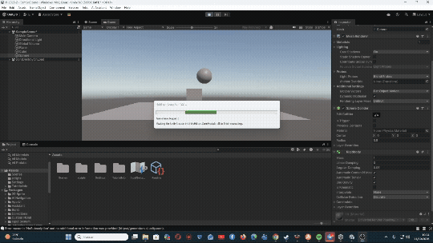

## Situación 3

En esta tercera situación podemos observar como el cubo sigue actuando de la misma manera debido a que este tiene un Rigidbody que al tener gravedad al iniciar la escena este se chocará con el plano que solamente es un Colider.

Sin embargo, por la parte de la esfera al ser cinemática no responde a la gravedad ni a las colisiones a no ser que se utilice un script.

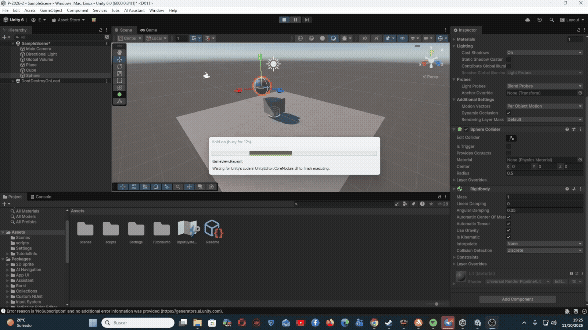

## Situación 4

En la cuarta situación todos son objetos físicos con RigidBody por lo que todos caeránn debido a la gravedad y no colisionarán.

## Situación 5

En esta quinta situación nos encontramos con que tanto el cubo como la esfera se chocan con el plano ya que aunque sea cinemático las colisiones están permitidas entre estos y los RigidBodys. Además la esfera al tener diez veces la masa del cubo se puede apreciar como esta mueve un poco al cubo por la fuerza que ejerce la esfera sobre el.

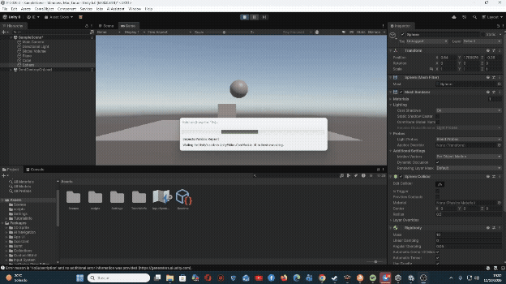

## Situación 6

En esta situación ocurre lo mismo que la anterior, solo que esta vez al tener la esfera 100 veces más masa que el cubo el movimiento del cubo al ser chocado por la esfera se ve más intensificado debido a la diferencia de masa con respecto a la anterior situación.

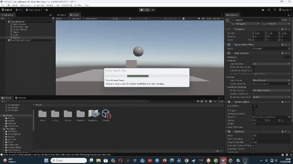

## Situación 7

En esta situación todos los objetos caen debido a que se nos pide que cada objeto sea físico y tengan RigidBody por lo que caen por la gravedad, sim embargo también se pide que la esféra tenga fricción, para conseguir eso se debe crear un nuevo material creando un `Phisic Material` al que se le pueden cambiar los valores tanto de su fricción dinámica, su fricción estática, como su elasticidad.

## Situación 8

Se nos pide en esta situación poner el plano cinemático, el cubo con un RigidBody y una esfera sin RigidBody pero con trigger, lo que hará que la esfera nunca caiga ya que no tiene físicas de gravedad.

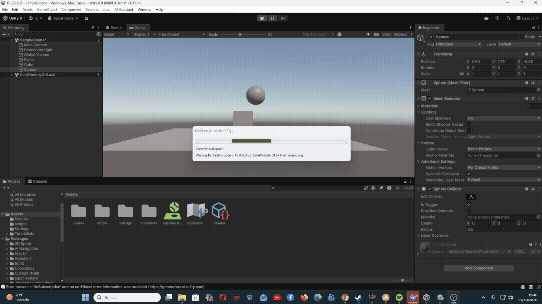

## Situación 9

Aquí si se pide que la esfera tenga físicas de RigidBody por lo que si caerá pero lo que podemos observar es que atravesará tanto el cubo como el plano, no ocurre ninguna colisión física pero si se podrían activar eventos trigger si en un script esto se refleja, pero solo con el objeto que tenga un RigidBody.

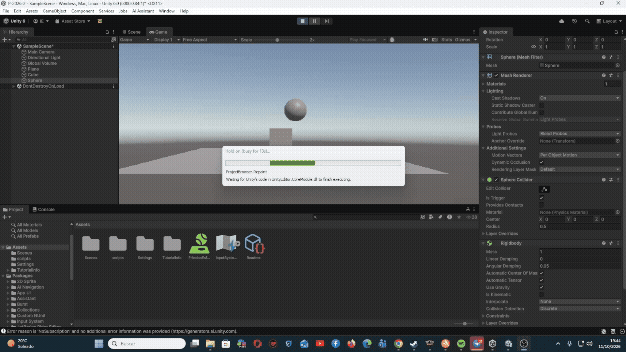

# Ejercicios

## Ejercicio 1

Para este primer ejercicio se nos pedía utilizar un objeto el cual pudiesemos mover utilizando las teclas WASD o las flechas del teclado, teniendo en cuenta de que el objeto debe tener RigidBody.

Para conseguirlo obtuvimos en el script el RigidBody del objeto mediante un `GetComponent<Rigidbody>()` y en el Update utilizamos tanto `Input.GetAxis("Horizontal")` como `Input.GetAxis("Vertical")` para saber cuando se presionaban las teclas. Finalmente dentro de un `FixedUpdate()` utilizamos el RigidBody del objeto para realizar un `MovePosition()` para ir moviendo el objeto.

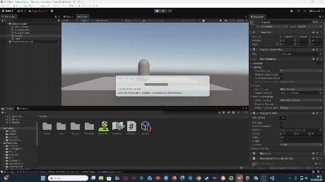

## Ejercicio 2

En este segundo ejercicio colocamos un conjunto de cubos y esferas con RigidBody dinámico y un script para cada objeto en el que se utilizaría una función llamada `OnCollisionEnter(Collision)` la cual en ella podemos reflejar todos los cambios que queremos que sucedan cuando ese objeto coplisione con otro en este caso mostrando por pantalla el objeto con el que colisiona y cambiando el color al objeto con la clase `Color`.

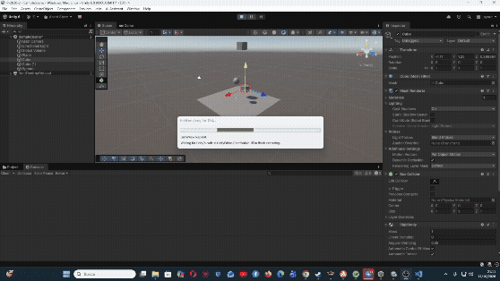

## Ejercicio 3

En este ejercicio a diferencia del anterior se nos pide que sucedan eventos a la hora de que nuestro personaje entre dentro de dos triggers que son cubos. Para ello se utilizarán unas funciones llamadas `OnTriggerEnter(Collision)` y `OnTriggerExit(Collision)`, una de ellas se utilizará para cambiar el color del personaje cuando entre en uno de los cubos y para añadir daño cuando entre en el otro, y la otra función servirá para cuando el personaje salga del cubo que disparará un evento donde el presonaje volverá a tener el color original.

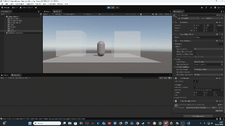

## Ejercicio 4

En este ejercicio se craeron tres objetos y cada uno con un capa distinta, una de jugador, una de enemigo y otra de recolectable, dentro de la Layer Collision Matrix se nos pidio que los enemigos solo se pudiesen colisionar con los jugadores y los recolectables al igual solo con el jugador y que estos recolectables fuesen triggers.

Una vez hecho eso se creó un script donde se pudiese mover al jugador y cada vez que se metiese dentro del objeto recolectable que era un trigger, utilizando la función `OnTriggerEnter(Collision)` se mostrase en pantalla como si recolectase un consumible además de mostrar como el jugador se podia chocar con el enemigo.

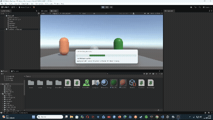

## Ejercicio 5

En este ejercicio se crearon tres esferas, cada una con un Physyc Material distinto:
- Uno rugoso con un nivel de fricción mayor.
- Uno resbaladiso con un nivel de fricción menor.
- Uno con rebote alto, con el valor del bounciness al 1.

Además se creó un script donde dentro del `Update` se encontrase cuando se presionase el botón X. Y si eso ocurria dentro de `FixedUpdate` se utilizase una función `AddForce()` donde se pondría la dirección de envio, la fuerza y por último el modelo de fuerza, en este caso el impulso.

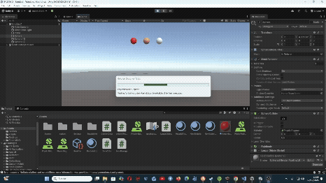

## Ejercicio 6

En este ejercicio se nos pide poner tres objeto alineados, un cubo, una esfera y un cilindro, a los que se nos pide que estos no tengan RigidBody ni Trigger, por lo que no actuarán ante las leyes de la física y no utilizarán el motor de físicas para poder hacer el enunciado de la misma donde se nos pide acercar el cubo al cilindro, mientras que en el momento que se encuentre con la esfera esta cambie de material.

Para lograrlo se utilizó la función de `Translate` utilizando como parametros el vector de desplazamiento obtenido de la resta entre la posición del objetivo con la del cubo y multiplicandolo por la velocidad y la función `Time.detaTime`. Además cuando se encontrasen el cubo y la esféra a una distancia mínima utilizando para ello la función `Vector3.Distance` entre la posición de los dos para poder cambiar el material.

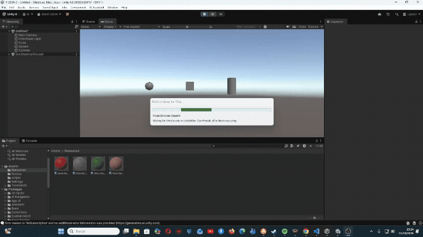